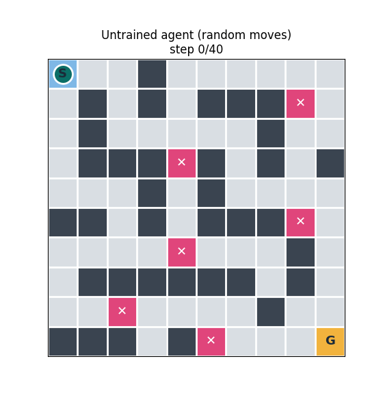
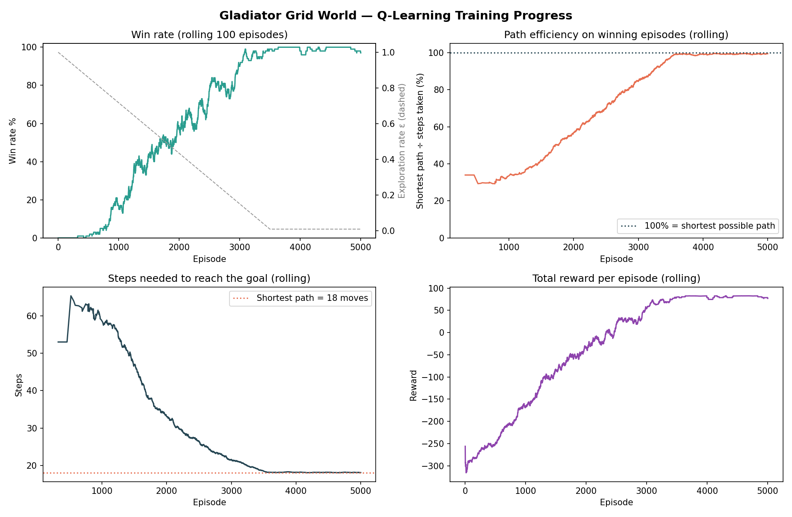
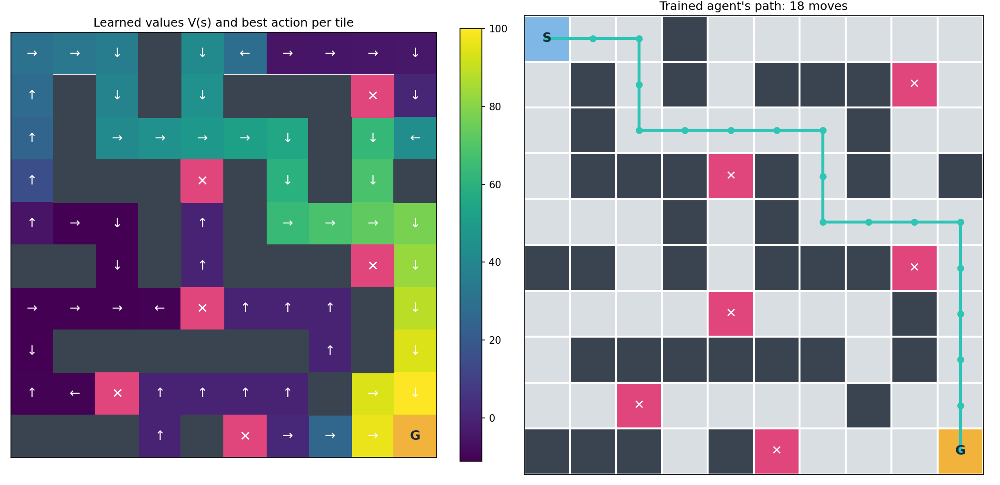

# ⚔️ The "Gladiator" Grid World — Q-Learning Agent

**AVIP 2026 · B.Y.T.E by Arithmatrix · AI/ML Engineering · Task 9**

A custom 2-D arena built with NumPy, and a **tabular Q-Learning** agent that starts with zero knowledge and teaches itself, through trial and error, to reach the goal by the **absolute shortest path** while avoiding every trap.

### 🌐 [Live demo: watch the agent learn](https://valorz1.github.io/AIML_9_GladiatorGridWorld_byte/)

| Untrained (random moves) | Fully trained (5,000 episodes) |
|---|---|
|  |  |

> **Result:** the trained agent reaches the goal in **18 moves**, exactly the shortest possible path, as verified by breadth-first search. Its win rate rose from **0.4%** in the first 500 episodes to **99.2%** in the last 500.

---

## 🗂 Project Structure

```
AIML_9_GladiatorGridWorld_byte/
├── gridworld_env.py          # the custom arena environment (NumPy)
├── train_agent.py            # Q-Learning training + plots + GIFs + saves the Q-table
├── play_agent.py             # watch the trained (or random) agent in your terminal
├── models/
│   ├── q_table.npy           # final Q-table (100 states × 4 actions)
│   └── q_table.csv           # same Q-table, human-readable, with best action per tile
├── outputs/
│   ├── training_progress.png # win rate, path efficiency, steps, reward over training
│   ├── policy_map.png        # learned values + best action for every tile
│   ├── trained_agent.gif     # fully trained agent solving the arena
│   ├── untrained_agent.gif   # random agent, for comparison
│   ├── training_log.csv      # results of all 5,000 episodes
│   └── results_summary.json
└── docs/                     # live web demo (GitHub Pages)
    ├── index.html
    └── replay_data.js        # generated by train_agent.py
```

## 🏟 Environment Rules

The arena is a 10 × 10 grid:

```
S . . # . . . . . .        S = start           G = goal
. # . # . # # # T .        # = wall            T = trap
. # . . . . . # . .        . = floor
. # # # T # . # . #
. . . # . # . . . .
# # . # . # # # T .
. . . . T . . . # .
. # # # # # # . # .
. . T . . . . # . .
# # # . # T . . . G
```

| Event | Reward | Effect |
|---|---|---|
| Any move | **−1** | Step penalty, so shorter paths score higher |
| Walk into a wall or the arena edge | **−5** | Agent stays in place |
| Step on a trap | **−100** | Episode ends (loss) |
| Reach the goal | **+100** | Episode ends (win) |
| 100 moves without finishing | — | Episode ends (timeout, loss) |

- **Actions:** up, right, down, left (one tile per move). **State:** the agent's tile (100 states).
- The environment is deterministic, and the shortest safe path is **18 moves**, which `shortest_path_length()` verifies with breadth-first search.
- The design is deliberately tricky: the shortest route passes right next to two traps (top-right and middle-right), so the agent has to learn a path that is both short **and** safe.

## 🧠 Algorithm: Tabular Q-Learning

The agent keeps a table `Q[state, action]`, its estimate of the total future reward for taking an action on a tile. After every move it updates that estimate with the Bellman equation:

```
Q(s, a) ← Q(s, a) + α · [ r + γ · max Q(s', a') − Q(s, a) ]
```

| Hyper-parameter | Value | Why |
|---|---|---|
| Episodes | 5,000 | Enough to converge on this map |
| Learning rate α | 0.1 | Steady, stable updates |
| Discount γ | 0.95 | Values the goal highly, but prefers reaching it sooner |
| Exploration ε | 1.0 → 0.01 (linear over 3,500 episodes) | Explore a lot early, then exploit what it learned |

How the reward function produces the shortest path: the **−1 per step** penalty and the **discount γ < 1** both make every extra move cost something, so the highest-scoring policy is the shortest route. The **−100 trap** penalty is large enough that no shortcut through a trap is ever worth it.

## 📈 Training Results



| Metric | First 500 episodes | Last 500 episodes |
|---|---|---|
| Win rate | 0.4% | **99.2%** |
| Episodes ending on a trap | 67.8% | **0.8%** |

- **First win:** episode 323.
- **Path efficiency** (shortest path ÷ steps taken, on winning episodes) climbs from about 30% to **100%** by episode 3,500.
- **Steps to reach the goal** fall from about 65 to exactly **18**.
- The last 0.8% of losses come from the 1% random exploration that's still switched on during training. The greedy trained agent wins every time.



The left panel shows what the agent learned: each tile's colour is its learned value (brighter means closer to winning), and the arrow is the best action from that tile. Values form a clear gradient that flows from the start towards the goal. Tiles far from the winning route (bottom-left) stay dark and have less meaningful arrows, because once the agent found the good route it rarely went there.

## 🚀 How to Run

```bash
pip install -r requirements.txt

# Train the agent (about 10–20 seconds): saves the Q-table, plots, GIFs and web data
python train_agent.py

# Watch the trained agent run the arena in your terminal
python play_agent.py

# Compare with an untrained agent making random moves
python play_agent.py --random
```

### Using the saved Q-table

```python
import numpy as np
from gridworld_env import GladiatorGridWorld

env, Q = GladiatorGridWorld(), np.load("models/q_table.npy")
s, done = env.reset(), False
while not done:
    s, reward, done, event = env.step(int(np.argmax(Q[s])))   # always take the best action
print(event, "in", env.steps, "moves")   # -> goal in 18 moves
```

## 🌐 Live Demo

[`docs/index.html`](docs/index.html) is a static web page that replays the agent's best route at 10 checkpoints during training (episodes 1 → 5,000), animates the trained agent, and can overlay the learned values and policy arrows. It's hosted free on GitHub Pages: **Settings → Pages → Deploy from a branch → `main` / `docs`**.

## 📝 Summary

This project builds a custom 10 × 10 grid environment in NumPy, with a start, a goal, walls and trap tiles, and trains a tabular Q-Learning agent to solve it. The reward function gives −1 per move, −5 for hitting a wall, −100 for a trap (episode lost) and +100 for the goal. Combined with a discount factor of 0.95, this makes the shortest safe route the highest-scoring policy.

Over 5,000 episodes with ε-greedy exploration decaying from 1.0 to 0.01, the agent went from a 0.4% win rate (67.8% of early episodes ending on a trap) to 99.2%. Its path efficiency rose to 100%: the final greedy policy reaches the goal in exactly 18 moves, matching the true shortest path found by breadth-first search, even though that route runs right past two traps. Training progress, the learned value map, before-and-after GIFs and an interactive web replay show how the behaviour emerged.

**Limitations:** tabular Q-Learning stores one value per tile, so it doesn't scale to large or continuous worlds, and it must be retrained if the map changes. A Deep Q-Network (DQN) would be the next step for bigger or randomised arenas.

---
*Built for the Arithmatrix Virtual Internship Program (AVIP) 2026 — B.Y.T.E by Arithmatrix.*
